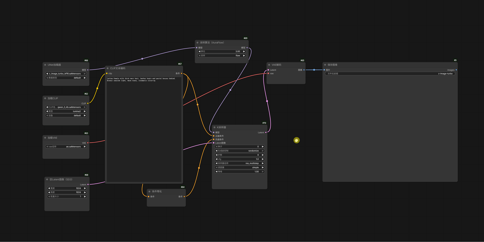

## ✂️ 划线断开 (Link Cut)

**操作方式**：按住 `Ctrl + 鼠标右键`，从画布空白处开始拖动，划过连线即可断开。

用于快速清理节点连接，无需选中节点。支持默认模式与 Nodes 2.0。

### ✨ 核心亮点

- **划过即断**：一次划动可断开多条连线。
- **渐亮提示**：按住 Ctrl 接近连线时逐渐高亮，越接近越亮。
- **鼠标轨迹**：划动时显示白色路径，结束后消失。
- **整次撤销**：通过 Ctrl＋Z 恢复一次划动断开的所有连线。

### 🎮 操作与功能

- **查看连线**：仅按住 Ctrl 移动鼠标，显示接近高亮，不断开连线。
- **切断连线**：从空白处按住 Ctrl＋右键划过连线，命中的连接立即断开。划过重叠连线或分支共用路径时，会断开该处所有命中的连接。
- **结束划动**：松开右键或 Ctrl，或按 Esc，清除轨迹。Ctrl 仍按住时保留接近高亮；已断开的连线通过 Ctrl＋Z 恢复。

### ⚙️ 设置与自定义 (Settings)

在 **插件设置 → 对齐布局 (AlignLayout) → 划线断开 (Link Cut)** 中调整。

#### 1. 功能开关

- **启用划线断开**：默认开启，可独立关闭此功能。

#### 2. 连线高亮与判定

- **高亮颜色**：默认 `#66CCFF`，调整连线高亮与发光颜色。
- **发光强度**：默认 `8`，设为 `0` 时仅保留颜色高亮。
- **高亮起始距离**：默认 `12px`，调整接近连线时开始渐亮的距离。
- **切断判定距离**：默认 `4px`，值越大越容易切断连线，与轨迹粗细无关。

两个距离均按屏幕像素计算，不随画布缩放变化；实际高亮起始距离至少比切断距离大 1px。

#### 3. 鼠标轨迹

- **显示鼠标轨迹**：默认开启，关闭后仍可正常断线。
- **轨迹颜色**：默认白色 `#FFFFFF`。
- **轨迹粗细**：默认 `2px`，按屏幕像素计算。
