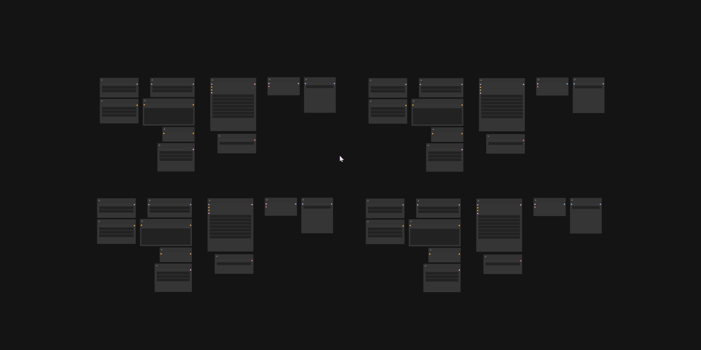
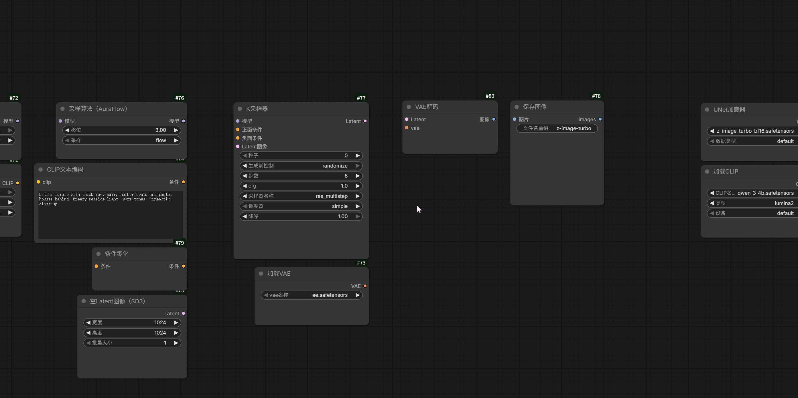
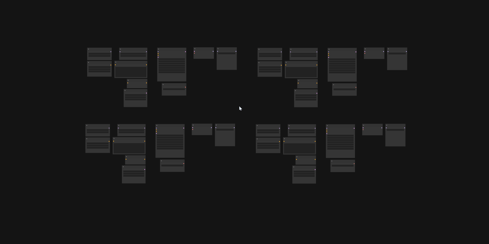
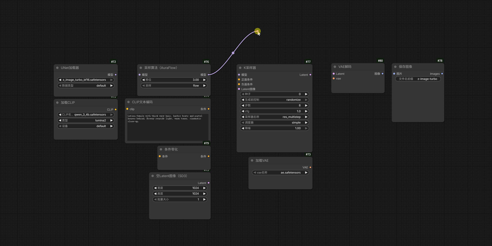
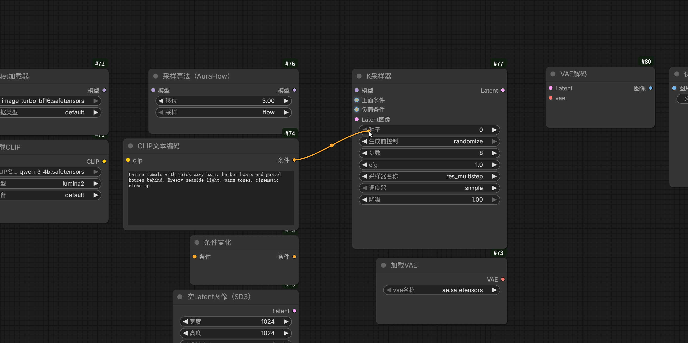

## 🔌 连接助手 (Connection Assistant)

**操作方式**：从端口拖出连线，保持左键按住，按一下 `Ctrl` 进入连线锁定；在目标端口上松开或点击确认。

用于画布缩小后看不清端口，或目标节点较远时接线。定位放大直接使用主画布上的真实节点，支持默认模式与 Nodes 2.0。

### ✨ 核心亮点

- **连线锁定**：从端口拖出连线，按一下 `Ctrl` 进入连线锁定；连线持续跟随鼠标。
- **悬停放大**：按住 Ctrl 查看节点，从放大的起始节点拉线时自动锁定。
- **菜单定位**：列出工作流中可连接的节点，通过搜索和悬停快速定位目标。
- **端口提示**：锁定后悬停节点，高亮全部兼容端口，包括参数输入。

### 🎮 操作与功能

#### 1. 连线锁定

从输入或输出端口按住左键拉线，保持左键按住再按一下 Ctrl，即可锁定连线。松开 Ctrl 或左键后，连线继续跟随鼠标。

在兼容端口上松开或点击左键确认连接；从输出拉线时，也可在高亮的参数控件上确认。右键或 Esc 取消，Ctrl＋Z 撤销已完成的连接。

#### 2. Ctrl 悬停放大

- **接线前**：按住 Ctrl 悬停节点，不按鼠标按钮，默认等待 200ms 后放大。从该节点端口拉线时自动进入锁定。
- **锁定后**：按住 Ctrl 悬停任意节点，立即开始定位放大，左键按住或松开均可。
- **结束放大**：松开 Ctrl 或移出节点，恢复本轮放大前的视图，已锁定的连线继续保留。

待连接时可用中键或空格＋左键平移、滚轮缩放，再通过 Ctrl 悬停查看附近节点。

#### 3. 连接菜单定位

锁定连线后，**在画布空白处单击左键**打开菜单；

菜单每个节点一项，仅显示 `#编号 节点名称`，可按名称或编号搜索。悬停选项默认等待 200ms，将目标节点定位并放大到菜单右侧；点击选项则立即定位。随后在真实节点上选择兼容端口确认连接。

#### 4. 兼容端口提示

连线锁定后，悬停目标节点即可高亮全部兼容端口，包括参数输入，无需按 Ctrl。鼠标移到具体端口或兼容参数控件上时，该目标增强高亮，可松开或点击左键确认连接。

### ⚙️ 设置与自定义 (Settings)

在 **插件设置 → 对齐布局 (AlignLayout) → 连接助手 (Connection Assistant)** 中调整。

#### 1. 功能开关

- **启用连接助手**：默认开启，控制整个功能。
- **接线前悬停放大**：默认开启，控制尚未接线时的 Ctrl 悬停放大。
- **拖线时悬停放大**：默认开启，控制连线锁定后的 Ctrl 悬停放大。

#### 2. 定位与高亮

- **预览缩放比例**：默认 `125%`，表示画布实际缩放比例；原视图更大时保持原缩放，空间不足时自动限制。
- **定位动画时长**：默认 `180ms`，用于定位及连接成功、取消后返回原视图；设为 `0` 时立即完成。
- **悬停等待时间**：默认 `200ms`，只影响接线前悬停和菜单选项悬停，锁定后 Ctrl 悬停仍立即定位。
- **节点高亮颜色**：默认 `#66CCFF`，用于节点、兼容端口及参数输入的高亮。
- **节点发光强度**：默认 `8`，设为 `0` 时只保留高亮描边。

#### 3. 菜单外观

- **菜单最大宽度**：默认 `360px`，按内容自适应，窄视图自动缩小。
- **菜单字体大小**：默认 `12px`，行高随字体保持多 2px，节点编号等宽对齐。
